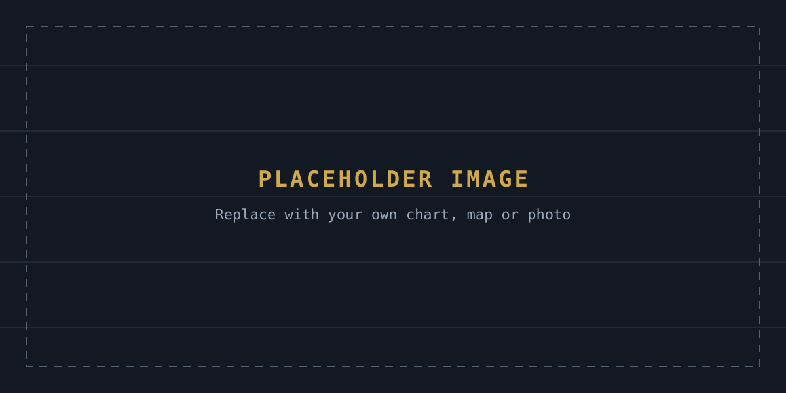

---
# ============================================================
# ARTICLE TEMPLATE — DRAFT, NOT PUBLISHED
# Copy this file, rename it, fill in the fields, and set
# draft: false (or delete the draft line) to publish.
# The file name becomes the URL:
#   content/articles/2026-senate-outlook.md
#   -> https://mustycaribou.com/articles/2026-senate-outlook.html
# See PUBLISHING.md for the full guide.
# ============================================================

title: "Example Article Template — Replace This Headline"
subtitle: "Optional one-sentence standfirst that appears under the headline. Delete this line if you don't need it."
description: "A one- or two-sentence summary (about 150 characters). Used on article cards, in Google results and in social previews."
author: "Your Name"
date: 2026-11-02
# updated: 2026-11-09        # optional — add when you revise a published article
category: Election Analysis   # Election Analysis | Polling | Forecasting | Australian Politics | US Politics
image: /assets/articles/placeholder-chart.svg   # optional — use a .jpg or .png (1200x630) for best social previews
image_alt: "Placeholder graphic"                # describe the image for screen readers
image_caption: "Placeholder image. Replace with your own graphic and credit it here."
featured: false               # true = shown as the lead story on the Articles page
draft: true                   # REMOVE this line (or set false) to publish

sources:
  - title: "Name of the source document or dataset"
    url: "https://example.com/replace-with-the-real-link"
    publisher: "Publisher name"
    date: 2026-11-01
  - title: "A second source (url, publisher and date are optional)"
---

This is the opening paragraph. Write normally in Markdown — a blank line starts a new paragraph. Everything in this file is placeholder text to show how each element looks once published.

## Use two hash marks for a section heading

Paragraphs can contain **bold text**, *italics* and [hyperlinks to sources](https://example.com/replace-with-the-real-link). Links to other pages on this site can be relative, like the [2026 forecast board](/forecast.html).

### Three hash marks for a sub-heading

- Bulleted lists use a hyphen
- One item per line

1. Numbered lists use numbers
2. Like this

> Block quotations start with a greater-than sign. Use them for quotes from candidates, officials or reports — and cite the source.

## Images and charts

Put image files in `assets/articles/` and reference them like this. The text in quotes becomes the caption:

For interactive charts from tools such as Datawrapper or Flourish, paste their embed code directly into the article as HTML.

## Tables

| Candidate     | Party | Poll average | Change |
|---------------|:-----:|-------------:|-------:|
| Placeholder A | D     | xx.x%        | +x.x   |
| Placeholder B | R     | xx.x%        | −x.x   |

Colons in the divider row set alignment: `:---:` centres a column, `---:` right-aligns numbers.

Rating chips from the forecast board also work: Toss-up Lean D Lean R

---

Close with a concluding paragraph. List every source in the `sources:` section at the top so it appears under "Sources & citations".
